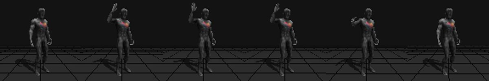

# First animation and export

Tar, Ava, and Manny (also called Manny Fingers) are available to every Uthana user. You can animate one of these characters without uploading your own. This walkthrough uses Tar, character ID `cXi2eAP19XwQ`.

[Tar's rigged GLB](../examples/tar/cXi2eAP19XwQ.glb) and [FBX](../examples/tar/cXi2eAP19XwQ.fbx) are also included if you want to try the upload workflow.

Tar is provided under the [Tar Demo Asset License](../examples/tar/LICENSE.md) for testing, evaluation, tutorials, and demos. Commercial evaluation is allowed; shipping Tar in a production game is not. Public demos must preserve Tar's appearance. Include the license when sharing editable Tar files. Processing Tar through Uthana is permitted under its service terms; Uthana retains the right to train on its own Tar assets. Do not authorize other processing services to train on Tar or derived materials. Use your own appropriately licensed character for a production game.

## What this walkthrough costs

One paid step: generating a four-second wave with Text-to-Motion 3.0 at $0.10 per second of generated motion. Everything else is free.

| Step | Cost |
| --- | --- |
| Check your balance, estimate the cost | Free |
| Generate a four-second wave with Text-to-Motion 3.0 | About $0.40 (the clip is 4.04 seconds, so the charge is $0.4042) |
| Preview frames and the Uthana viewer link | Free |
| Export the same motion as FBX with mesh | Free |
| Fresh download link, or fetching the file again | Free; no new export |
| **Total** | **About $0.40** |

New accounts start with $5 of free credit, which covers this walkthrough. The credit is spent at the normal rates. If you ask for another generation or a retry, that is charged again; getting the same result back is not. Your assistant provider's own charges, if any, are separate. Older subscription plans use a monthly download allowance for exports instead. See [what each operation costs](pricing.md) for every tool and account type.

## Prepare

Choose how you connected:

- **Hosted:** follow the [connection guide](https://uthana.com/docs/api/capabilities/hosted-mcp), then ask your agent to show your account’s available balance and allowances without creating or changing anything. No local install or API key is needed.
- **Local:** [install and connect](installation.md), then ask your agent to show your account’s available balance and allowances without creating or changing anything. You can also run `uthana-mcp-smoke --api-read` with your API key configured in the terminal for a read-only account check.

Use Tar ID `cXi2eAP19XwQ` for this walkthrough. If multiple characters are named Tar, select by ID.

### Optional: use your own character

You can upload a bipedal FBX/GLB instead of using a built-in character:

- **Hosted:** sign in to the [file portal](https://mcp.uthana.com/files) with the account you connected to your agent. Upload the file and paste the upload details into your conversation. This makes the file available to your agent; it does not create a character yet.
- **Local:** save the file in the folder configured as `UTHANA_MCP_INPUT_DIR`. Give your agent the file's path in that folder.

Ask your agent to upload the selected file as a character. Use `auto_rig=false` for an already-rigged file, or `auto_rig=true` for an unrigged biped. Use the returned character ID in place of Tar below and review the rig before animating it.

To practice uploading with the bundled Tar GLB, use `auto_rig=false`; it is already rigged. The 5.4 MB file is self-contained, has a 79-joint skin, and contains no animation. [Hashes and the alternate FBX](../examples/tar/README.md) let you verify it. The uploaded copy has its own character ID.

## Step 1: generate a wave

> Use Uthana's built-in Tar character (cXi2eAP19XwQ) and Text-to-Motion 3.0 to create a four-second wave. Estimate the price first, then generate one motion if the estimate is at most $0.50. Show preview frames and the link to view the saved motion. If interrupted, recover the existing request rather than generate another.

What to expect:

- **Estimate:** $0.40 for four seconds at $0.10 per second.
- **Wait:** generation usually takes about 1–2 minutes, sometimes longer when the service is busy. That is the wait, not the clip length: the clip is four seconds long.
- **Preview:** frames of Tar raising the right hand to head height, waving, and lowering it. Hosted connections also return a link that opens the motion in the Uthana app.

Generated motion varies from run to run. Following these steps gives you the same workflow, settings, and kind of result, not an identical animation. If the wave is not what you wanted, ask for another one; that is a new generation and is charged again.

The $0.50 is an instruction your assistant follows. Uthana does not enforce a per-request budget. Your balance is the only hard limit: once it runs out, new paid work is refused, and a job already running can take it up to $1 below zero. Auto top-up is off unless you turn it on.

## Step 2: export the same motion

> Export that same saved motion as FBX with the character mesh at 30 FPS. Give me the download and the short Blender import instructions. Retrieve the existing file if it has already been exported.

This step exports the motion you already have. It does not create a new animation and is free. With hosted access, your assistant can fetch the file or give you a download link. Links expire after 15 minutes. Ask for a fresh link to the same file if one expires; that does not export or charge again. Keep working links private. With the local connector, the file is saved on the machine running the connector.

## Step 3: open it in Blender

Follow the [Blender guide](blender.md): set the scene to 30 FPS, then import the FBX with **File → Import → FBX** and press Play. No other cleanup is needed. Checked with Blender 5.0.1 on November 4, 2026: the import contains the armature and the skinned `Manny_HP` mesh, the animation runs from frame 1 to 120 (four seconds at 30 FPS), and the right hand rises to about 1.9 m during the wave. If you export GLB instead, Blender's glTF importer adds an `Icosphere` object as the bones' display shape. It is not in the exported file; hide it or leave it.

## If something goes wrong

- **Not enough credit:** your assistant reports a low balance or a declined request. Add credit at [your account settings](https://uthana.com/app/account), then ask it to continue the same task.
- **Tar or the motion is not available:** your account cannot access that character or motion. Check that you are signed in to the account you connected, then contact support@uthana.com.
- **Generation failed:** a failed generation is not charged. Ask your assistant to try once more, or change the prompt.
- **Interrupted or timed out:** the job is probably still running. Ask your assistant to check the previous request and retrieve its result before generating again.

## Next steps

- **Your own video:** turn a video of a person into motion with video-to-motion. Upload it through the [file portal](https://mcp.uthana.com/files) (hosted) or your input folder (local).
- **Your own character:** upload a rigged FBX/GLB as described under "Optional: use your own character" above, then export the same wave onto it. Retargeting an existing motion to another character is free.
- **Combine motions:** join two motions with a transition, or make a loop. See [stitching](stitching.md).

## Review the result

Open the exported file in the target editor or engine. Check that the expected skeleton and mesh are present, the character has the right scale and facing, the animation plays at the expected frame rate, and root motion behaves as desired. A successful Uthana export does not prove it imports and plays correctly in Unreal, Unity, Maya, Blender, or Three.js. Record the engine/editor version and import settings with any issue.

Try a visible, ordinary biped with separated arms and legs first. Already-rigged characters are generally the more direct retargeting path. For auto-rigging, avoid large wings, backpacks, held props, intersecting limbs, and flowing or rigged clothing until the specific character has been checked. If a result is poor, preserve the original asset and report the limitation rather than describing it as a supported success.

## For agents

Choose a durable request ID for each mutation. `generate_motion` returns a job ID; `get_job` later returns a motion ID when complete. `get_preview` and `get_preview_frame` help review timing and action. Use `get_artifact_download` with the existing artifact ID to refresh an expired hosted link. With local stdio, keep the state directory across restarts. If a task is interrupted, check `get_request_status` before starting it again.
